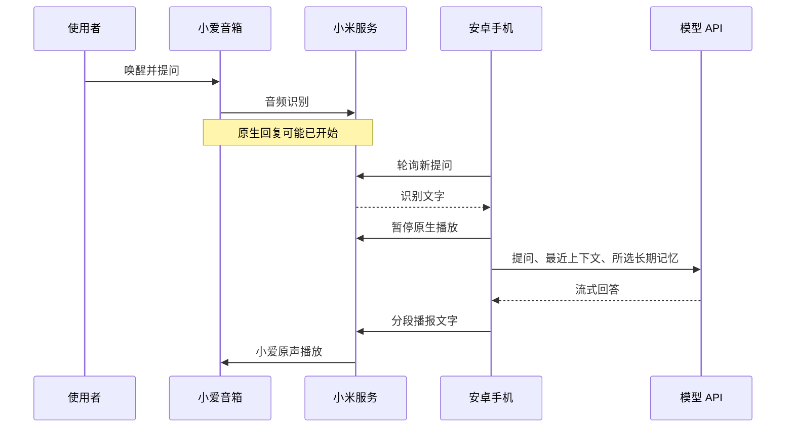

# 原理、实测与限制

[返回首页](../README.md)

## 一次问答经过哪些环节



项目无法在小米原生识别之前获取音箱麦克风音频，也不能从手机修改音箱固件的应答顺序。即使减少手机端等待，原生回复仍可能先响。当前每秒轮询一次，沿用上游节奏，不通过高频请求绕过服务限制。

## 体验优化分别在哪里

| 文件 | 职责 |
|---|---|
| `app/run.py` | 继承 XiaoGPT：处理口令、追问超时、暂停去重、运行状态 |
| `app/voice_settings.py` | 自然口语提示、回答长度、记忆开关 |
| `app/memory_bot.py` | 将记忆接入上下文；保存和删除指令在本地处理 |
| `app/local_memory.py` | SQLite、候选规则、确认与超时、容量限制 |
| `app/speech_buffer.py` | 最多缓冲约 0.4 秒，合并临近短句减少播报切换 |
| `app/configure.py` | 登录、模型测试、播报和提问读取验收 |
| `phone/` | Termux 服务、有限重试、中文菜单 |
| `app/wait_network.py` | 开机时先等网络，使用公开 TCP 连接，不发送凭证 |
| `phone/autostart.sh` | 注册／停用本项目 Termux:Boot 入口，保留其他启动脚本 |

中文原声路径跳过语言检测，暂停原声时省去一次先查播放状态的往返；同一记录成功暂停后不再重复暂停。若暂停请求失败，问答服务继续工作，错误只记录经过筛选的类型和代码。

上游原生 TTS 按文字估算时长后再查询播放状态，句间停顿仍可能存在；本项目没有承诺消除它。流式生成快也不等于音箱立刻出声，识别、轮询、网络控制和播放均有耗时。

## 记忆模型

```text
普通提问 → 正常回答 → 发现明确偏好 → 询问是否记住
                                       ├─ 确认 → SQLite
                                       ├─ 拒绝 → 丢弃
                                       └─ 超时／换话题／重启 → 丢弃
```

没有向量库、嵌入模型或本地大语言模型。检索用中文相邻双字片段重合度排序，最多选 8 条；不是语义检索，相关性有限。当前会以最近记忆补足上下文候选，不能保证所有不相关记忆都不会发送到模型；模型提示要求仅在相关时使用。

家庭多人共用音箱时没有声纹身份隔离。确认前请避免把他人信息存成当前用户偏好，不要把此功能当作可靠的多人身份系统。

## 实测范围

| 项目 | 结果 |
|---|---|
| 参考音箱 | MDZ-25-DA / S12 |
| 参考手机 | Mi 9 Pro 5G / Android 11，约 12GB RAM |
| 用户环境报告 | MIUI 13.0.1 |
| Linux / Python | Ubuntu 24.04.3 ARM64 / Python 3.12.3 |
| 主依赖 | XiaoGPT 3.24 / MiService 3.0.1 |
| DeepSeek 问答、锁屏回答、两轮追问 | 用户实测通过 |
| 明确记忆、自动建议确认后保存 | 用户实测通过 |
| 无标点的语音识别 | 已修复候选漏判并通过复测 |
| Edge 固定音色样本 | URL type 1，设备 HTTP 拉取和用户试听均通过 |
| 自动唤醒下一轮 | 未通过，小米 IoT 返回 -127 / client withdraw；默认关闭 |
| 完全阻止原生回复 | 未实现 |
| 脚本开机自启 | 可选 Termux:Boot 入口，首次解锁后等待网络，需系统允许后台启动 |
| 新安装器在第二台全新手机上验收 | 尚未完成 |

参考模型接口单次测试约 1.6 秒返回首句文字，不包含整条语音链路。不同网络、设备、API 或小米服务变化都会影响结果。除参考组合外，其他手机或音箱不应视为已支持。
